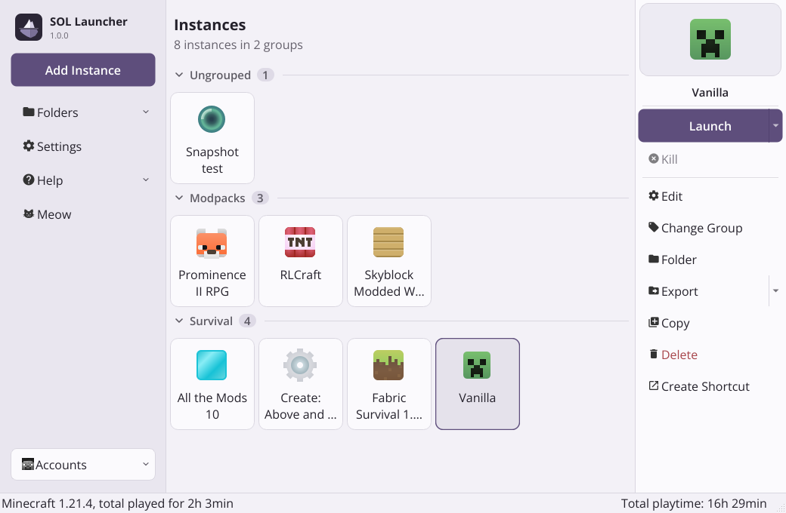
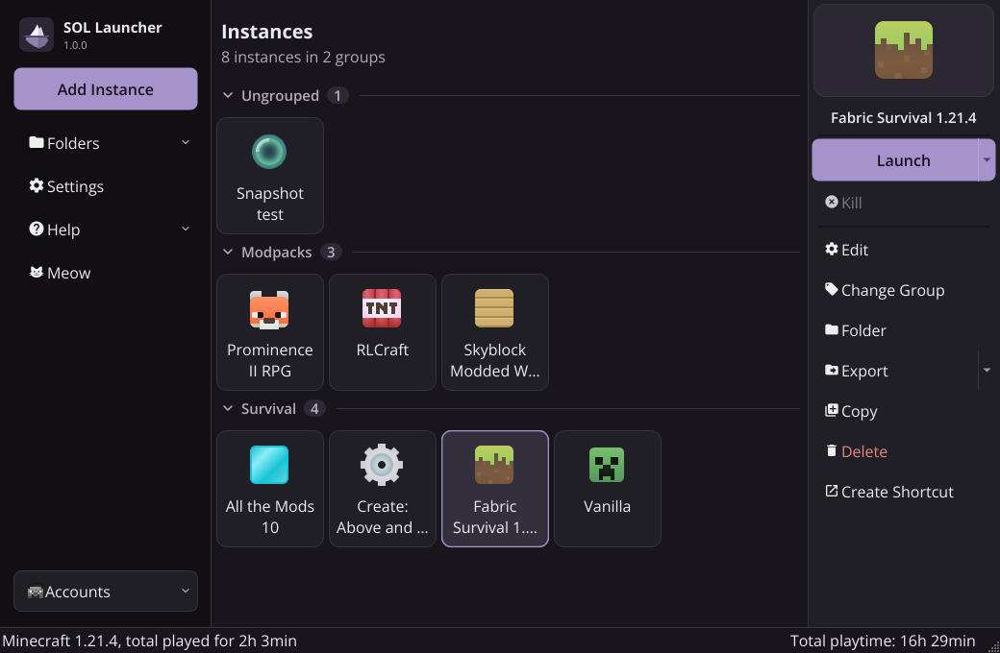

<p align="center">
<picture>
  <source media="(prefers-color-scheme: dark)" srcset="/program_info/io.github.solfain.SOLLauncher.logo-darkmode.svg">
  <source media="(prefers-color-scheme: light)" srcset="/program_info/io.github.solfain.SOLLauncher.logo.svg">
  
</picture>
</p>

<h1 align="center">SOL Launcher</h1>

<p align="center">
  A calm Minecraft launcher for managing many installations at once.<br />
  Light-first design, sidebar navigation, and everything you know from a modern instance manager.
</p>

> **SOL Launcher is an independent project. It is not Prism Launcher, and it is not endorsed by or affiliated with the
> Prism Launcher project.** It is a derivative work of the free software
> [Prism Launcher](https://prismlauncher.org) (GPL-3.0), which itself descends from PolyMC and MultiMC. All of the
> launching, account, instance, modpack, Java and settings functionality comes from that code base; SOL Launcher changes
> how it looks and how the main window is organised. See [docs/sol/FORK_NOTES.md](docs/sol/FORK_NOTES.md).

<p align="center">
  
  
</p>

<p align="center"><sub>SOL Light and SOL Dark, captured from the real application. SOL uses the system UI font; these were taken on a
Linux build that only had Open Sans installed, so on Windows the same screens render in Segoe UI.</sub></p>

## What is different

- **A new visual identity.** A restrained, lavender-tinted light theme (and a matching dark one) with a deliberately
  low-chroma violet accent: flat surfaces, hairline borders, no gradients, glow or glass. The logo is a simple iceberg.
  See [docs/sol/DESIGN.md](docs/sol/DESIGN.md).
- **A sidebar-based main window.** Navigation (add instance, folders, settings, help, accounts) lives in a sidebar,
  instances are shown as cards under a page header, and the selected instance's actions sit in a panel on the right.
- **Its own data folder.** SOL Launcher stores everything in a `SOLLauncher` folder, never touching an existing Prism
  Launcher installation, so the two can run side by side.

Everything else is unchanged: launching Minecraft, Microsoft account sign-in, instance management, modpack support
(CurseForge, Modrinth, FTB, ATLauncher, Technic, import/export), Java configuration and all settings.

## Building

SOL Launcher is a C++23 / Qt 6.8+ application built with CMake. There are no binary releases yet, so you build it
yourself:

```
git clone --recurse-submodules https://github.com/solfain/prism-remake.git
cd prism-remake
```

> **Do not use GitHub's "Download ZIP" button to get the source.** The archive leaves out git submodules
> (`libraries/libnbtplusplus`, `cmake/vcpkg`), so the build would stop with a missing-directory error. Clone with
> `--recurse-submodules` as above, or follow the ZIP workaround in [docs/sol/BUILDING.md](docs/sol/BUILDING.md#getting-the-source).

Step-by-step instructions for Windows (MSVC + vcpkg) and Linux are in [docs/sol/BUILDING.md](docs/sol/BUILDING.md).

### API keys

SOL Launcher does not ship Prism Launcher's API keys. Until you provide your own, **Microsoft sign-in, CurseForge and
Imgur uploads are switched off** (everything else works). You can supply them at build time
(`-DLauncher_MSA_CLIENT_ID=...`, `-DLauncher_CURSEFORGE_API_KEY=...`) or at run time in **Settings > APIs**.
Details and the reasoning are in [docs/sol/FORK_NOTES.md](docs/sol/FORK_NOTES.md).

## Where your data lives

| Platform | Default location                       |
| -------- | -------------------------------------- |
| Windows  | `%APPDATA%\SOLLauncher`                |
| Linux    | `~/.local/share/SOLLauncher`           |
| macOS    | `~/Library/Application Support/SOLLauncher` |

Set `SOLLAUNCHER_DATA_DIR` or pass `--dir` to use another folder, or create a `portable.txt` next to the executable for
a portable install.

## Documentation

- [Building SOL Launcher](docs/sol/BUILDING.md)
- [Design notes: palette, themes, layout, logo](docs/sol/DESIGN.md)
- [Fork notes: relationship to Prism Launcher, API keys, services, upstream sync](docs/sol/FORK_NOTES.md)
- [What changed compared to the Prism Launcher baseline](docs/sol/CHANGES.md)

## License and credits

SOL Launcher is free software licensed under the **GNU General Public License, version 3** (see [LICENSE](LICENSE) and
[COPYING.md](COPYING.md)). It is built on the work of the Prism Launcher, PolyMC and MultiMC contributors, whose
copyright notices are preserved in the source files and in the in-app credits.
