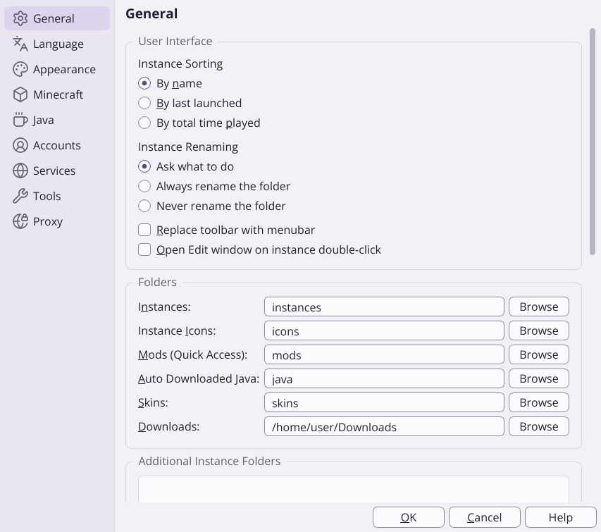
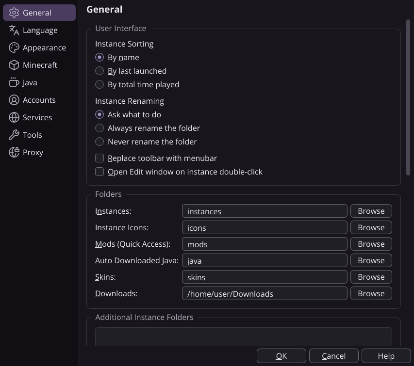
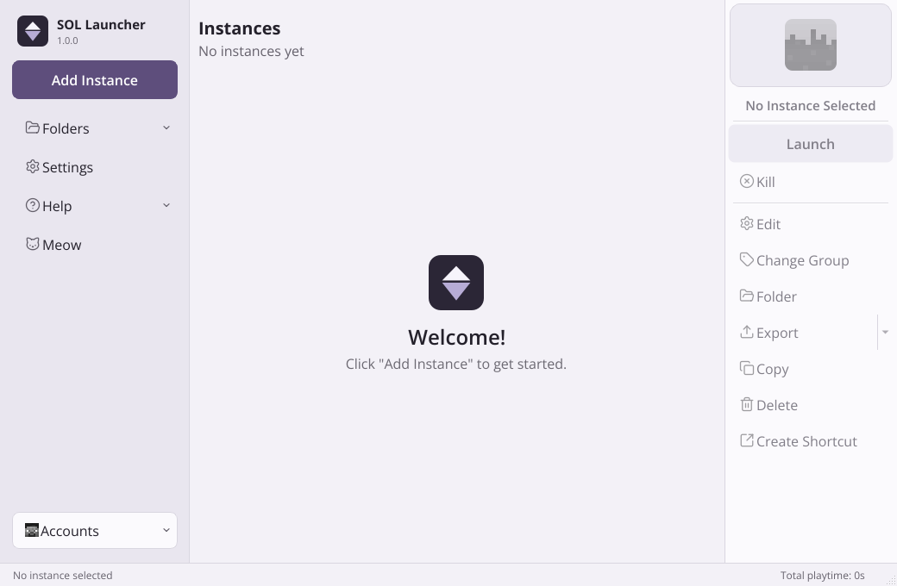
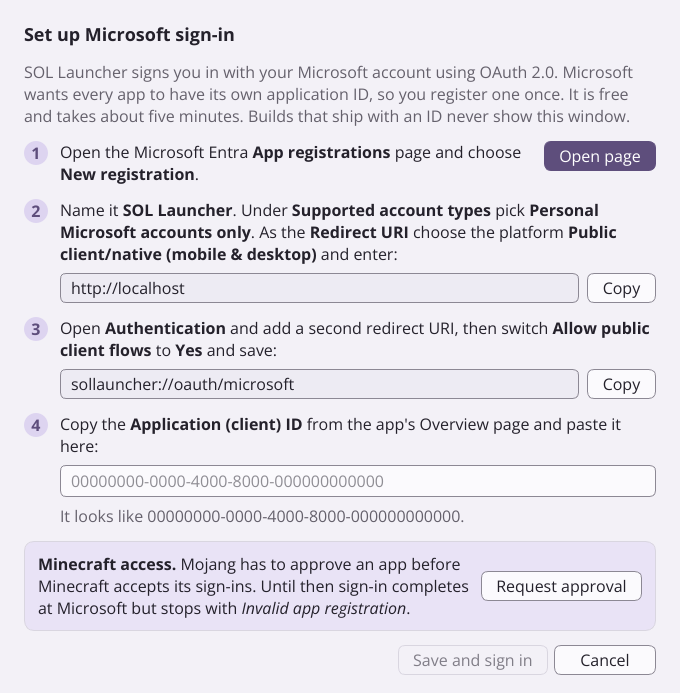

# SOL Launcher design notes

The brief: a distinct visual identity ("something like whitish purple, but not AI-vibecoded purple"), a very simple
logo (an iceberg, then simplified further), and a restructured main window with sidebar navigation, all implemented in the existing Qt Widgets code base.

## Screenshots

Real captures of the application (the headless Linux build used for verification). The theme sets no font of its own,
so the UI uses the system font; these shots were taken with Open Sans because that was the only font installed, and on
Windows the same screens render in Segoe UI.

| Light | Dark |
| --- | --- |
|  |  |
|  |  |

The first-run / empty library state, and the guided Microsoft sign-in setup:

| | |
| --- | --- |
|  |  |

## Principles

- **Light-first, quiet, flat.** Lavender-tinted off-whites, hairline borders, one accent colour. No gradients, no glow,
  no glass, no drop shadows.
- **The accent is deliberately desaturated.** The usual "AI purple" (Tailwind violet/indigo, Bootstrap purple, Material
  deep purple) has an OKLCH chroma of 0.19 to 0.25. SOL's accent has a chroma of **0.075** (light theme) and 0.084 (dark
  theme): it reads as a dusty heather violet instead of a saturated neon one. Surfaces are tinted even less (chroma
  0.004 to 0.013, hue 300), so they read as slightly cool off-whites rather than as "purple".
- **Contrast first.** Colours are derived in OKLCH and checked against WCAG: body text 13:1 or better, secondary text
  at least 4.9:1, the accent fill with its label 6.8:1 or better, input outlines at least 3:1. The only intentionally
  softer pair is disabled / placeholder text (3.6:1 light, 4.2:1 dark).
- **Everything derives from the palette.** Custom-painted widgets (instance cards, group headers, empty state) read
  `QPalette` roles, so they also look right under Prism's older themes (Dark, Bright, System...), which remain
  available. They read the *application* palette (`QApplication::palette()`) rather than the widget's own: a stylesheet
  `background` rule rewrites the Base / Window / Button roles of the widget it applies to, which made the cards paint
  black before this was fixed.

## Palette

The single source of truth is [`launcher/resources/sol/tokens.json`](../../launcher/resources/sol/tokens.json).

| Token | Light | Dark | Used for |
| --- | --- | --- | --- |
| `bg` | `#F3F1F7` | `#18161C` | Window background / page |
| `surface` | `#FBFAFD` | `#211F26` | Cards, inputs, menus ("paper") |
| `surfaceAlt` | `#EDEBF3` | `#2B2831` | Alternate rows, hover on cards |
| `sidebar` | `#E9E6EF` | `#110F14` | Sidebar and settings page list |
| `sidebarHover` | `#F3F0F8` | `#201D25` | Hover on sidebar entries |
| `border` | `#D9D6E0` | `#383440` | Hairlines, dividers |
| `controlBorder` | `#8C8894` | `#6D6A75` | Outline of inputs and checkboxes |
| `ink` | `#24212B` | `#ECEAF1` | Primary text |
| `inkMuted` | `#65616C` | `#AEAAB7` | Secondary text, section labels |
| `inkFaint` | `#817E88` | `#7C7885` | Disabled text, placeholders |
| `accent` | `#5E4E7C` | `#A693CC` | Call-to-action fill, focus, links, selection |
| `accentHover` | `#534370` | `#B4A0DB` | Accent while hovered |
| `accentPress` | `#483962` | `#9886BB` | Accent while pressed |
| `accentSoft` | `#E9E3F6` | `#362E46` | Selected rows, menu highlight |
| `accentSoftStrong` | `#DDD4F0` | `#493C5F` | Selected sidebar / page entries |
| `accentTrack` | `#CCC1E4` | `#5B4C76` | Progress bar fill, disabled accent |
| `onAccent` | `#FFFFFF` | `#15121C` | Text on the accent fill |
| `success` | `#35775D` | `#6BB797` | Running / OK |
| `danger` | `#A74449` | `#E68485` | Errors, destructive actions |
| `warning` | `#8D621C` | `#D9B06B` | Warnings |

Contrast of the pairs that matter:

| Pair (text on background) | Light | Dark |
| --- | --- | --- |
| `ink` on `bg` | 14.1:1 | 15.0:1 |
| `ink` on `surface` | 15.2:1 | 13.7:1 |
| `inkMuted` on `bg` | 5.4:1 | 7.9:1 |
| `inkMuted` on `sidebar` | 4.9:1 | 8.4:1 |
| `inkFaint` on `bg` (disabled / placeholder) | 3.6:1 | 4.2:1 |
| `accent` on `bg` (links, focus ring) | 6.6:1 | 6.6:1 |
| `onAccent` on `accent` (button label) | 7.4:1 | 6.8:1 |
| `ink` on `accentSoft` (selection) | 12.6:1 | 10.8:1 |
| `controlBorder` on `surface` (input outline) | 3.3:1 | 3.1:1 |
| `danger` / `success` / `warning` on `bg` | 5.3 / 4.7 / 4.8:1 | 6.8 / 7.6 / 8.9:1 |

## How the theme works

| Piece | Where | What it does |
| --- | --- | --- |
| Colour tokens | `launcher/resources/sol/tokens.json` | light and dark value for every token above |
| Stylesheet template | `launcher/resources/sol/sol.qss.in` | one flat Qt stylesheet with `@token@` placeholders; also contains the rules for the sidebar, the instance panel and the page header |
| Control images | `launcher/resources/sol/{light,dark}/*.svg` | chevrons, check mark, radio dot (they need a fixed colour, so there is one set per variant) |
| Theme class | `launcher/ui/themes/SolTheme.{h,cpp}` | builds the `QPalette` from the tokens, substitutes the placeholders, supplies themed log colours |
| Registration | `ThemeManager::initializeWidgets()` | adds "SOL Light" and "SOL Dark" and lists them first |
| First run default | `Application.cpp` | the OS colour scheme only decides light vs. dark; the flat icon set (`flat` / `flat_white`) is the default icon theme |

`SolTheme` extends Prism's existing `FusionTheme`, so the theme manager, the settings page, the setup wizard and custom
`themes/` folders work exactly as before. To tune the look, edit `tokens.json` (colours) or `sol.qss.in` (shapes,
spacing) and rebuild; both are compiled into the executable as resources.

Control heights are normalised: buttons, line edits, combo boxes and spin boxes are all 28 px tall at the default font
size, so they line up when placed in one row.

## Layout

```
+-----------+--------------------------------------------+-----------+
| SOL       |  Instances                                  |  [icon]   |
| Launcher  |  8 instances in 2 groups                    |  Name     |
|           |                                             | [Launch]  |
| [Add inst]|  v Survival  4 ---------------------------- |  Kill     |
| Folders v |  +------+ +------+ +------+ +------+        |  ------   |
| Settings  |  | card | | card | | card | | card |        |  Edit     |
| Help    v |  +------+ +------+ +------+ +------+        |  Group    |
| Updates   |                                             |  Folder   |
| Cat       |  v Modpacks  3 ---------------------------- |  Export v |
|           |  ...                                        |  Copy     |
| [Account v|                                             |  Delete   |
+-----------+--------------------------------------------+-----------+
```

- **Sidebar (left).** The old top toolbar became a fixed sidebar: brand, a call-to-action ("Add Instance"), Folders,
  Settings, Help, updates, the cat toggle, and the account button at the bottom. It is the same `QToolBar` and the
  same `QAction`s as before, so shortcuts, the "menu bar instead of toolbar" setting and every handler are untouched.
  The entries are `SidebarButton`s (`launcher/ui/widgets/SidebarButton.*`), small widgets that mirror an action.
- **Page header.** Title and an "N instances in M groups" line above the grid.
- **Instance cards.** Fixed-size cards (icon, two-line name) with a hairline, an accent outline when selected and a
  subtle outline on hover. Group headers show a chevron, the group name and a count pill. An empty library shows the
  logo and a short hint instead of a dark box.
- **Instance panel (right).** The existing instance toolbar, restyled: icon card, name, a filled "Launch" button and
  the other actions as rows; destructive actions are tinted.
- **News bar.** Only shown when a news feed URL is configured (none by default).

Behaviour that did not change: selection, double-click to launch, rename (F2 / inline), groups and collapsing,
drag-and-drop import, context menus, keyboard shortcuts, running / crashed status badges.

## Logo

One shape: **a diamond split at the waterline**. The lit tip above the line is the part of the iceberg you see, the larger,
calmer mass below it is the part you don't. Two flat tones with a thin gap for the waterline, no strokes, one bold
silhouette that is still legible at 16 px. The application icon puts it on a dark ink-violet rounded tile; the plain marks
(for light and dark pages) are `program_info/io.github.solfain.SOLLauncher.logo*.svg`.

`program_info/gen_sol_icons.py` regenerates every icon format (SVG, PNG, Windows `.ico`, macOS `.icns` and the macOS 26
icon layers, plus the in-app `launcher.svg`) from one definition of the mark
(`pip install PySide6-Essentials Pillow`). Four alternates that were considered stay available behind a flag:
`python3 program_info/gen_sol_icons.py --mark gem|shard|floe|frost` (`--list` shows them): the same diamond split
vertically, a single two-facet shard, the previous iceberg silhouette, and a six-spoke frost crystal.

Logo and icons are original to SOL Launcher; they are not Prism Launcher artwork.

## Icons

Toolbar, menu, page-list and message-box icons are one thin line set: 45 [Lucide](https://lucide.dev) drawings (ISC licence,
copied unmodified into `launcher/resources/sol_icons/lucide/`) mapped to the names the launcher already asks for.
`launcher/resources/sol_icons/generate_icons.py` colours them from `tokens.json`: muted ink for ordinary icons, the success /
warning / danger colours for the status icons, 1.75 px strokes.

The theme is **adaptive**. Choosing the icon theme "SOL Line" means "the strokes that read on the active palette": it resolves
to the dark-stroke set on light themes and to the light-stroke set (`sol_white`, hidden from the lists) on dark ones, and is
re-resolved whenever an application theme is applied. The old flat / flat_white pair had to be chosen by hand to match the
theme, and a mismatch meant invisible icons. Both sets inherit from the flat themes, so the Discord and Reddit brand glyphs
(which have no line equivalent) still resolve. Message boxes use the same icons (a warning is the palette's amber, an error
its red) while a SOL icon theme is active.

## Motion

Small, quick and never in the way. Hover and selection of an instance card ease over 140 ms (out-cubic, on a timer that only
runs while something moves), so moving across the grid cross-fades the cards instead of flicking them. A classic mouse wheel
scrolls with a 180 ms ease; touchpads keep their own smooth scrolling. Nothing animates that the user is waiting on, and
nothing animates a layout.
